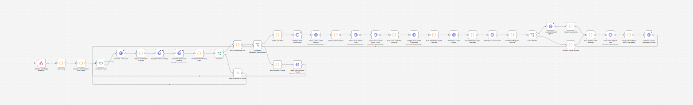

# Closed-Won Client Onboarding Orchestrator

[](LICENSE)
[](https://github.com/dhrobinsystems/closed-won-client-onboarding-orchestrator/actions/workflows/ci.yml)
[](https://n8n.io)
[](https://nodejs.org)
[](package.json)

**From "Closed Won" to a provisioned client onboarding in seconds, with no duplicate provisioning and no client contacted before a person approves.**

An enterprise-grade **n8n + Node.js** post-sale orchestration engine. When a HubSpot deal moves to `Closed Won`, it:

1. Checks a **strict idempotency key**, so a rep toggling stages can never provision twice.
2. Provisions a dedicated **Slack channel** (`client-<slug>-onboarding`) with your internal team.
3. Creates a structured **Google Drive** hierarchy: `YYYY-MM - <Company>/01_Contracts_and_SOW, 02_Discovery_and_Intake, 03_Deliverables, 04_Meeting_Notes`.
4. Initializes a **project workspace** from a task template (ClickUp, Asana or Notion behind one abstraction).
5. Drafts a **kickoff agenda via LLM**, grounded in the deal's intake notes and validated for hallucinations, with a deterministic fallback.
6. Posts a **human-in-the-loop approval gate** to `#cs-handoffs`. External client emails are invited and the welcome packet is sent only after a listed approver clicks **Approve External Invites**.
7. Writes status and an **audit trail** back to the HubSpot deal timeline.

All of it is protected by **`SANDBOX_MODE=true` by default**.

Built and maintained by **DH Robin** ([dhRobin Systems](https://dhrobinsystems.com), `dhrobinsystems`).

---

## Table of contents

- [Architecture](#architecture)
- [Safety rails & idempotency](#safety-rails--idempotency)
- [Quick start](#quick-start)
- [Environment variables reference](#environment-variables-reference)
- [Repository structure](#repository-structure)
- [Testing & quality gates](#testing--quality-gates)
- [Disclaimer](#️-disclaimer--liability-limitation)
- [License](#license)

---

## Architecture

### 1. Closed Won Provisioning Orchestrator


### 2. Client Invite Approval Dispatcher


Business logic is written once in `src/` as pure, dependency-free CommonJS modules and tested with `node --test`. `npm run build` compiles it into the Code nodes of the n8n workflows, and CI fails if the workflows drift from `src/`. See [docs/ARCHITECTURE.md](docs/ARCHITECTURE.md) for the full design.

### Workflow 01: Closed Won Provisioning Orchestrator


| # | Node | What it does |
| --- | --- | --- |
| 1 | **HubSpot Deal Stage Webhook** | Receives `deal.propertyChange` (dealstage) events and responds 200 immediately. |
| 2 | **Load Config** | Validates every env var, fails fast, and emits a *redacted* config. `SANDBOX_MODE` defaults to `true`. |
| 3 | **Verify & Extract Closed-Won Events** | Optional HubSpot v3 signature check. Keeps only Closed Won transitions, one per deal. |
| 4 | **Loop Over Deals** | Isolates each deal in batched deliveries. |
| 5 | **HubSpot: Fetch Deal / Company / Batch Read Contacts** | Re-fetches the source of truth. Event payloads are never trusted for data. |
| 6 | **Validate & Idempotency Gate** | Normalizes the payload, confirms the deal is *still* Closed Won, computes the key, evaluates CRM state, and takes the in-flight lock. |
| 7 | **Build Provisioning Plan** | Deterministic manifest: channel, Drive tree, tasks, grounded LLM prompt, invite plan. |
| 8 | **Live Mode? (SANDBOX_MODE=false)** | Only the exact value `live` continues. Everything else goes to the **sandbox preview**. |
| 9 | **Assert Live Mode → HubSpot: Mark Provisioning** | Re-checks the environment, then writes `onboarding_status=provisioning` + key *before* creating anything. |
| 10 | **Slack: Create Client Channel → Resolve → Invite Internal Team** | Private channel, internal members only. Refuses to reuse an existing channel. |
| 11 | **Google Drive: Create Client Folder → Subfolders** | `YYYY-MM - Company` root plus four numbered subfolders (shared drives supported). |
| 12 | **Workspace: Create Project → Create Tasks** | Provider-agnostic HTTP built by the planner (ClickUp List, Asana Project, Notion page). |
| 13 | **LLM Enabled? → Draft → Validate / Fallback** | Grounded agenda. Ungrounded output (emails, URLs, money, missing company) falls back to the template. |
| 14 | **Build & Post Approval Gate** | Rich Block Kit summary with **Approve External Invites / Hold** buttons. |
| 15 | **Verify Gate Posted → HubSpot: Update Onboarding Record** | Stores `awaiting_approval`, channel ID, Drive URL and workspace URL. |

### Workflow 02: Client Invite Approval Dispatcher


| # | Node | What it does |
| --- | --- | --- |
| 1 | **Slack Interactivity Webhook** | Receives button clicks (raw body kept for signing). |
| 2 | **Load Config** | Approval-context validation (signing secret required in every mode). |
| 3 | **Verify Signature & Parse Action** | Slack v0 HMAC with a replay window. Parses only after verification. Validates the button value, the `response_url` host, the approver allowlist, and blocks sandbox artifacts. |
| 4 | **Signature Valid? → Acknowledge (200) / Reject (401)** | Answers Slack within 3 s. |
| 5 | **Authorized Request? → Rejection Notice** | Ephemeral "not permitted" reply for unauthorized clicks. |
| 6 | **HubSpot: Fetch Deal / Company / Contacts** | Fresh CRM state for the decision. |
| 7 | **Plan Dispatch** | State machine: key, deal and channel must match. Double clicks are skipped. Invite policy is re-applied. Sandbox runs produce a preview only. |
| 8 | **Live Dispatch? → Invite External Contact → Welcome Packet** | Slack Connect invite per approved email, then a welcome message in the client channel. |
| 9 | **Audit Note → Update Onboarding Status → Update Approval Message** | HubSpot timeline note, `client_invited`, and the Slack message replaced with the outcome. |
| 10 | **Live Hold? → Hold Audit → Mark On Hold** | Records the hold and keeps the Approve button for later. |
| 11 | **Slack: Post Outcome Notice** | Sandbox previews, skips and blocks are reported back internally. |

---

## Safety rails & idempotency

### `SANDBOX_MODE=true` by default

* With no configuration, the engine runs in **sandbox**. It reads HubSpot and posts a **dry-run preview** to the internal channel showing the exact channel name, folder tree, tasks and invite list. It creates, invites and writes **nothing**.
* Only `false`, `0`, `no` or `off` disable sandbox. Typos (`flase`) keep it **on** and raise an error.
* Defense in depth: every live branch starts with a node that **re-reads the environment and throws** if sandbox is on. `npm run check` statically proves that no mutating HTTP node is reachable in sandbox.
* Sandbox approval buttons are labelled `(Sandbox)` and are **rejected** by a live dispatcher.

### Duplicate deal-toggle protection

```
key = "cwo-v1-" + hash64("v1 | dealId | stageId | normalizedAccountDomain")
```

* The key and `onboarding_status=provisioning` are written to the deal **before** any resource is created.
* Closed Won → Contract Sent → Closed Won produces the **same key**, and the gate returns `SKIP_ALREADY_PROVISIONED`.
* Duplicate webhook deliveries within seconds hit a short-lived **in-flight lock** (`SKIP_IN_FLIGHT`).
* A crashed run (`provisioning` with no lock), a `failed` run, or a changed domain (`BLOCK_KEY_CONFLICT`) requires **human review**. There are no blind retries.

### Human-in-the-loop before external contact

* Workflow 01 **never** invites external emails or messages the client.
* Workflow 02 acts only on a **Slack-signed** click by a user in `APPROVER_SLACK_USER_IDS`. It re-checks the deal's key, status and channel in HubSpot and enforces the **invite domain policy** (company domain or allowlist, capped per deal).
* A second click after dispatch is a no-op (`SKIP_ALREADY_DISPATCHED`). Every outcome is logged to the HubSpot timeline.

### Data minimization & integrity

* Contact **emails are never sent to the LLM**. Intake notes are sanitized and treated as untrusted input (prompt-delimiter injection is neutralized).
* LLM output is validated for grounding before it reaches Slack.
* CRM text is escaped for Slack (`<!channel>` and link injection blocked) and for HubSpot note HTML.
* Secrets never appear in execution data, and credentials ship as `REPLACE_WITH_YOUR_CREDENTIAL_ID`.

---

## Quick start

### Option A: Direct JSON import into n8n

1. Download [`workflows/01-closed-won-provisioning-orchestrator.json`](workflows/01-closed-won-provisioning-orchestrator.json) and [`workflows/02-client-invite-approval-dispatcher.json`](workflows/02-client-invite-approval-dispatcher.json).
2. In n8n, open **Workflows → Import from File** and import both.
3. Set the host environment: copy the variables from [`.env.example`](.env.example) and add `N8N_BLOCK_ENV_ACCESS_IN_NODE=false` and `NODE_FUNCTION_ALLOW_BUILTIN=crypto`. Keep `SANDBOX_MODE=true`.
4. Replace every `REPLACE_WITH_YOUR_CREDENTIAL_ID` by selecting your HubSpot, Slack, Google Drive, workspace and (optional) LLM credentials on the flagged nodes.
5. Point the HubSpot webhook and Slack Interactivity at the two production webhook URLs, then activate both workflows.
6. Move a test deal to Closed Won and review the **SANDBOX DRY RUN** in `#cs-handoffs`.

Full walkthrough, including HubSpot properties and Slack scopes: **[docs/SETUP.md](docs/SETUP.md)**.

### Option B: Full developer setup

```bash
git clone https://github.com/dhrobinsystems/closed-won-client-onboarding-orchestrator.git
cd closed-won-client-onboarding-orchestrator

npm test           # run the full test suite (no npm install needed)
npm run simulate   # offline dry run on samples/sample-closed-won-deal.json
npm run build      # compile src/*.js into the workflow Code nodes
npm run check      # integrity, credentials, secrets, sync and sandbox-gate checks
```

Change logic in `src/`, add tests in `tests/`, run `npm run build`, then re-import the JSON into n8n.

---

## Environment variables reference

| Variable | Default | Required | Description |
| --- | --- | --- | --- |
| `SANDBOX_MODE` | `true` | - | Dry-run switch. Only `false/0/no/off` enable live mode. Invalid values stay in sandbox. |
| `HUBSPOT_CLOSED_WON_STAGE_ID` | `closedwon` | - | Internal ID of the Closed Won stage. |
| `HUBSPOT_PIPELINE_ID` | *(empty)* | - | Restrict to one pipeline. |
| `HUBSPOT_PORTAL_ID` | *(empty)* | - | Builds deal links in Slack. |
| `HUBSPOT_INTAKE_NOTES_PROPERTY` | `deal_intake_notes` | - | Deal property with intake notes for LLM grounding. |
| `HUBSPOT_APP_CLIENT_SECRET` | *(empty)* | Recommended | Enables HubSpot v3 webhook signature verification. |
| `HUBSPOT_WEBHOOK_TARGET_URL` | *(empty)* | If secret set | Exact public URL HubSpot calls. |
| `SLACK_INTERNAL_APPROVAL_CHANNEL` | `#cs-handoffs` | - | Channel ID or `#name` for approval gates and previews. |
| `SLACK_CHANNEL_PREFIX` | `client` | - | Client channel prefix (`client-<slug>-onboarding`). |
| `SLACK_PRIVATE_CHANNELS` | `true` | - | Create client channels as private. |
| `SLACK_INTERNAL_MEMBER_IDS` | *(empty)* | Live | Internal Slack user IDs added to each client channel. |
| `APPROVER_SLACK_USER_IDS` | *(empty)* | Live | Users allowed to Approve / Hold. |
| `SLACK_SIGNING_SECRET` | *(empty)* | Workflow 02 | Verifies Slack interactivity requests. |
| `SLACK_SIGNATURE_TOLERANCE_SECONDS` | `300` | - | Replay window (30-900). |
| `DRIVE_PARENT_FOLDER_ID` | *(empty)* | Live | Parent Drive folder for client folders. |
| `WORKSPACE_PROVIDER` | `clickup` | - | `clickup`, `asana` or `notion`. |
| `WORKSPACE_CONTAINER_ID` | *(empty)* | Live | ClickUp Space ID, Asana Team GID or Notion parent page ID. |
| `LLM_PROVIDER` | `none` | - | `none`, `openai` or `anthropic`. |
| `LLM_MODEL` | *(empty)* | If LLM on | Model name for the provider. |
| `LLM_MAX_TOKENS` | `1200` | - | Output token cap (200-8000). |
| `LLM_TEMPERATURE` | *(provider default)* | - | Optional, 0-1. |
| `EXTERNAL_INVITE_DOMAIN_POLICY` | `match_company_domain` | - | Or `allowlist`. |
| `EXTERNAL_INVITE_ALLOWED_DOMAINS` | *(empty)* | If allowlist | Comma-separated domains. |
| `MAX_EXTERNAL_INVITES` | `10` | - | Per-deal invite cap (1-50). |
| `ORG_DISPLAY_NAME` | `Our Team` | - | Your company name in the client welcome packet. |
| `IDEMPOTENCY_LOCK_TTL_MINUTES` | `15` | - | In-flight duplicate lock lifetime. |

n8n host settings: `N8N_BLOCK_ENV_ACCESS_IN_NODE=false`, `NODE_FUNCTION_ALLOW_BUILTIN=crypto`.

---

## Repository structure

```
closed-won-client-onboarding-orchestrator/
├── .github/workflows/ci.yml            # Node 20 & 22: test, check, build-drift
├── assets/                             # workflow screenshots (placeholders)
├── docs/
│   ├── ARCHITECTURE.md
│   └── SETUP.md
├── samples/sample-closed-won-deal.json # fictional data, example.* domains only
├── scripts/
│   ├── lib/bundler.js
│   ├── build-workflows.js
│   ├── check-workflows.js
│   └── simulate.js
├── src/
│   ├── approval.js
│   ├── config.js
│   ├── idempotency.js
│   ├── provisioning-planner.js
│   ├── sanitizer.js
│   ├── security.js
│   └── slack-blocks.js
├── tests/                              # node --test suites + n8n Code-node harness
├── workflows/
│   ├── 01-closed-won-provisioning-orchestrator.json
│   └── 02-client-invite-approval-dispatcher.json
├── .env.example
├── CONTRIBUTING.md
├── DISCLAIMER.md
├── LICENSE
└── package.json
```

---

## Testing & quality gates

* **`npm test`** runs 120+ tests covering idempotency collisions and deal toggles, Slack slug sanitization, Drive tree generation, LLM prompt grounding and hallucination rejection, signature verification, approval state machines, and `SANDBOX_MODE` fail-safes. It also **executes the real Code-node source from the workflow JSON** in a sandboxed n8n emulator.
* **`npm run check`** validates JSON integrity, placeholder credentials, the absence of hardcoded secrets, bundle sync with `src/`, compilation of every Code node, and the static sandbox-reachability proof.
* **CI** runs both on Node.js 20 and 22 for every push and pull request, and verifies that `npm run build` produces no diff.

Contributions are welcome. See [CONTRIBUTING.md](CONTRIBUTING.md).

---

## ⚠️ Disclaimer & Liability Limitation

Use at your own risk. The code, workflows, and scripts provided in this repository (`closed-won-client-onboarding-orchestrator`) are for educational and architectural demonstration purposes.

- **No Liability:** The author and dhRobin Systems assume no responsibility or liability for any direct, indirect, incidental, or consequential damages resulting from the use, misuse, or inability to use these workflows, including unintended external client invitations, workspace provisioning actions, or CRM data modifications.
- **No Warranty:** All software, JSON blueprints, and JavaScript modules are provided "AS IS" without warranty of any kind, express or implied, including but not limited to merchantability, fitness for a particular purpose, or non-infringement.
- **Production Testing Required:** Always test thoroughly in an isolated staging environment with `SANDBOX_MODE=true` enabled before connecting live HubSpot, Slack, Google Workspace, or project management production credentials.
- **Third-Party APIs & Compliance:** Users are solely responsible for complying with the terms of service, rate limits, data privacy regulations (GDPR/CCPA), and security policies of HubSpot, Slack, Google Drive, and any connected LLM providers.

> The full disclaimer is also available in [DISCLAIMER.md](DISCLAIMER.md).

---

## License

Released under the [MIT License](LICENSE). Copyright (c) 2026 DH Robin (dhRobin Systems).
