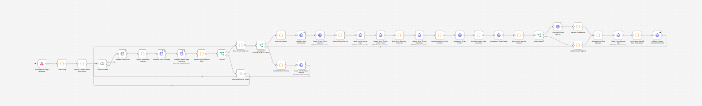

# Architecture

`closed-won-client-onboarding-orchestrator` turns a HubSpot **Closed Won** deal into a provisioned, human-approved client onboarding. Workflow 01 creates the internal resources. Workflow 02 waits for a person to approve before anything is sent to the client. Both workflows run the same tested, dependency-free JavaScript, compiled from `src/`.

## 1. Design principles

| Principle | How it is enforced |
| --- | --- |
| **Fail safe** | `SANDBOX_MODE` is on unless explicitly set to a recognised false value. The live branch is selected only when `mode === "live"`, and every live branch re-reads the environment before writing (`Assert Live Mode`, `Prepare Invite Requests`, `Prepare Hold Record`). |
| **Idempotent** | Deterministic key `hash(v1 \| dealId \| stageId \| normalizedDomain)`, stored on the deal before any resource is created, plus a short-lived in-flight lock in n8n static data. |
| **Human in the loop** | External client emails are never invited by workflow 01. Only a listed approver, clicking a signed Slack button, can trigger workflow 02. Workflow 02 re-checks all state against HubSpot first. |
| **Single source of truth** | Business logic lives only in `src/`. `npm run build` compiles it into the Code nodes, and `npm run check` and CI fail on any drift. |
| **Zero runtime dependencies** | Pure CommonJS modules, Node's native test runner, no `npm install`. |
| **Least data to the LLM** | Only company and deal facts, attendee names and titles, and sanitized intake notes are sent. Email addresses never are. The output is validated for grounding, with a deterministic fallback. |

## 2. Repository layout

```
src/                         Pure business logic (no I/O)
  config.js                  env parsing/validation, SANDBOX_MODE default, redaction
  sanitizer.js               HubSpot payload normalizer, email/domain validation,
                             Slack channel slugs, Drive folder names, event extraction
  security.js                Slack v0 + HubSpot v3 signature verification,
                             constant-time compare, response_url SSRF guard
  idempotency.js             key builder, provisioning gate, in-flight lock ledger,
                             approval-dispatch state machine
  provisioning-planner.js    manifest builder: Slack, Drive tree, workspace requests
                             (ClickUp/Asana/Notion), grounded LLM prompt + validator,
                             invite plan, HubSpot updates & audit notes
  slack-blocks.js            Block Kit: approval gate, sandbox preview, welcome packet,
                             outcome / rejection notices
  approval.js                Slack interactivity parsing, approver authorization,
                             dispatch planning against fresh CRM state
scripts/
  lib/bundler.js             CommonJS stripping, dependency ordering, bundle markers
  build-workflows.js         injects compiled src/ into workflow Code nodes
  check-workflows.js         integrity, credentials, secrets, sync and sandbox-gate checks
  simulate.js                offline dry run on samples/
workflows/                   importable n8n JSON (generated regions + node glue)
tests/                       node --test suites, including a vm-based Code-node harness
```

### How code reaches n8n

Each Code node has a generated region followed by a short block of hand-written glue:

```js
// ==== BEGIN GENERATED BUNDLE (modules: config, idempotency, sanitizer) - DO NOT EDIT; run `npm run build` ====
// ...src/sanitizer.js, src/config.js, src/idempotency.js with CommonJS removed...
// ==== END GENERATED BUNDLE ====

// ---- Node glue (hand-written; safe to edit) ----
const { config } = requireValidConfig(snapshotEnv($env).env, { context: 'provisioning' });
```

The marker lists the *entry* modules. The bundler resolves `require('./x')` dependencies and emits them in topological order. Because each node is self-contained, the JSON files are large (about 0.5 MB each). That is the price of no external dependencies and no custom n8n nodes.

## 3. Workflow 01: Closed Won Provisioning Orchestrator



```
HubSpot Deal Stage Webhook ─► Load Config ─► Verify & Extract Closed-Won Events ─► Loop Over Deals
   ┌───────────────────────────────────────────────────────────────────────────────────┘
   └► HubSpot: Fetch Deal ─► Prepare Association Lookups ─► Fetch Company ─► Batch Read Contacts
      ─► Validate & Idempotency Gate ─► Proceed? ──no──► Stop: Duplicate or Invalid ─► (loop)
                                            │yes
                                            ▼
                                  Build Provisioning Plan ─► Live Mode? ──no──► Build Sandbox Preview ─► Slack: Post Sandbox Preview ─► (loop)
                                                                 │yes
                                                                 ▼
   Assert Live Mode ─► HubSpot: Mark Provisioning ─► Slack: Create Client Channel ─► Resolve Slack Channel
   ─► Slack: Invite Internal Team ─► Drive: Create Client Folder ─► Build Drive Subfolder Requests
   ─► Drive: Create Subfolders ─► Build Workspace Project Request ─► Workspace: Create Project
   ─► Build Workspace Task Requests ─► Workspace: Create Tasks ─► Build Kickoff Agenda Request ─► LLM Enabled?
        ├─yes─► LLM: Draft Kickoff Agenda ─► Validate LLM Agenda ─┐
        └─no──► Fallback Kickoff Agenda ──────────────────────────┴► Build Approval Gate Message
   ─► Slack: Post Approval Gate ─► Verify Gate Posted & Build CRM Update ─► HubSpot: Update Onboarding Record ─► (loop)
```

Key behaviours:

* **Event payloads are not trusted for data.** The webhook only provides deal IDs. Deal, company and contacts are always re-fetched from the HubSpot API, and the gate checks that the deal is *currently* in the Closed Won stage.
* **Batched deliveries.** HubSpot can send up to 100 events per request. `Loop Over Deals` processes them one at a time, so `$('Node').first()` references always point to the current deal.
* **CRM write before resource creation.** `onboarding_status=provisioning` and the key are written first. If a run fails part-way, the next event sees `provisioning` with no active lock and stops with `BLOCK_REQUIRES_REVIEW` instead of creating duplicates.
* **No channel reuse.** If `conversations.create` returns `name_taken`, the run stops. A channel of unknown ownership is never reused for external invites.
* **LLM resilience.** The LLM node continues on error. `Validate LLM Agenda` rejects ungrounded output (unknown emails, URLs or money figures, or a missing company name) and falls back to the template.

## 4. Workflow 02: Client Invite Approval Dispatcher


```
Slack Interactivity Webhook ─► Load Config ─► Verify Signature & Parse Action ─► Signature Valid?
   ├─no──► Reject: Invalid Signature (401)
   └─yes─► Acknowledge Slack (200) ─► Authorized Request?
              ├─no──► Build Rejection Notice ─► Slack: Post Rejection Notice (ephemeral)
              └─yes─► HubSpot: Fetch Deal ─► Prepare Association Lookups ─► Fetch Company ─► Batch Read Contacts
                     ─► Plan Dispatch ─► Live Dispatch?
                           ├─yes─► Prepare Invite Requests ─► Slack: Invite External Contact (per email)
                           │       ─► Collect Invite Results & Build Welcome ─► Slack: Post Welcome Packet
                           │       ─► Build Dispatch Audit Record ─► HubSpot: Create Audit Note
                           │       ─► HubSpot: Update Onboarding Status ─► Build Approval Confirmation ─► Slack: Update Approval Message
                           └─no──► Live Hold?
                                     ├─yes─► Prepare Hold Record ─► HubSpot: Create Hold Audit Note ─► HubSpot: Mark On Hold
                                     │       ─► Build Hold Confirmation ─► Slack: Post Hold Confirmation
                                     └─no──► Slack: Post Outcome Notice (sandbox preview / skipped / blocked)
```

Checks performed before any invite:

1. Slack **v0 signature** over the exact raw body, with a configurable replay window. The payload is parsed only after verification.
2. The button value is validated (`v`, deal ID, idempotency-key format, channel ID, sandbox flag), and `response_url` must be on `hooks.slack.com` (SSRF guard).
3. The clicking user must be in `APPROVER_SLACK_USER_IDS` (closed by default in live mode).
4. Buttons from a sandbox preview are rejected in live mode.
5. Fresh HubSpot state must match: same deal, same stored key, same stored channel, and a status that allows the action (`awaiting_approval` or `on_hold` for approve). A second click after dispatch returns `SKIP_ALREADY_DISPATCHED`.
6. The invite policy is re-applied (company domain or allowlist, with a per-deal cap).

If every invite fails, the deal stays `awaiting_approval` and the approval message is kept so the action can be retried.

## 5. State model (`onboarding_status` on the deal)

```
(empty) ──WF01 start──► provisioning ──WF01 success──► awaiting_approval ──Approve──► client_invited
                              │                                │  ▲
                        crash/failure                        Hold │ Approve
                              ▼                                ▼  │
                   BLOCK_REQUIRES_REVIEW (operator)           on_hold
```

To retry after a failure, review any partial resources, then clear `onboarding_status` and `onboarding_idempotency_key` on the deal.

## 6. Sandbox enforcement layers

1. `config.js`: default on; unparseable values stay on and raise an error.
2. Mode gates: only the exact value `live` routes to live branches (`Live Mode?`, and `planApprovalDispatch` never returns `dispatch`/`hold` in sandbox).
3. Runtime assertions: the first node of every live branch re-reads `SANDBOX_MODE` from the environment and throws if it is on.
4. Static analysis: `check-workflows.js` walks the connection graph and fails if any mutating HTTP node can be reached in sandbox without crossing a `[sandbox-gate]` output, unless it is marked `[sandbox-safe]` (read-only HubSpot batch reads and internal previews).
5. Blocked `$env` (`N8N_BLOCK_ENV_ACCESS_IN_NODE=true`) results in defaults, which means sandbox.

## 7. Security notes

* Secrets (`SLACK_SIGNING_SECRET`, `HUBSPOT_APP_CLIENT_SECRET`) are read from the environment inside the nodes that need them and are never written to item JSON, so they don't appear in n8n execution logs. `Load Config` emits only a redacted config.
* API tokens live only in n8n credentials. The JSON ships with the placeholder `REPLACE_WITH_YOUR_CREDENTIAL_ID`, and the checker rejects inline `Authorization` headers.
* Slack mrkdwn escaping blocks `<!channel>` and link injection through CRM fields. HubSpot note bodies are HTML-escaped.
* Intake notes are untrusted. Prompt delimiters inside them are neutralized, and the system prompt tells the model to ignore embedded instructions.
